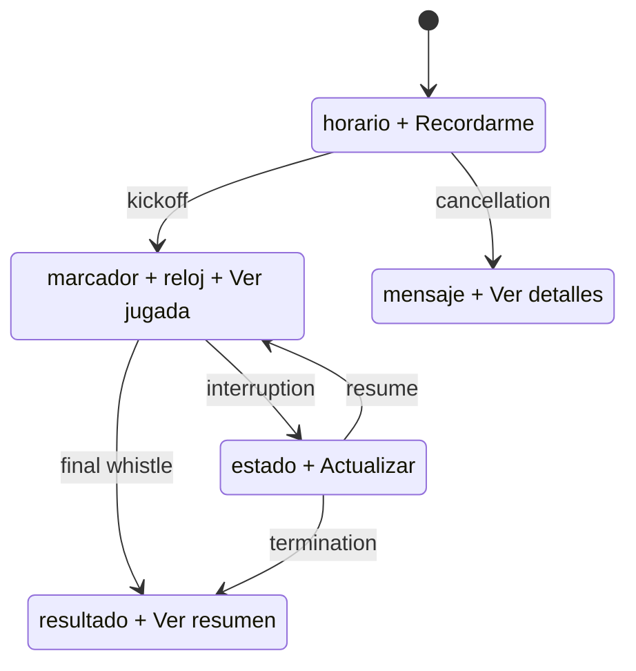
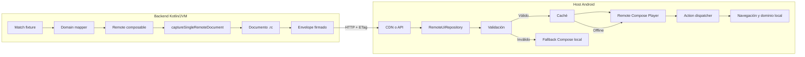
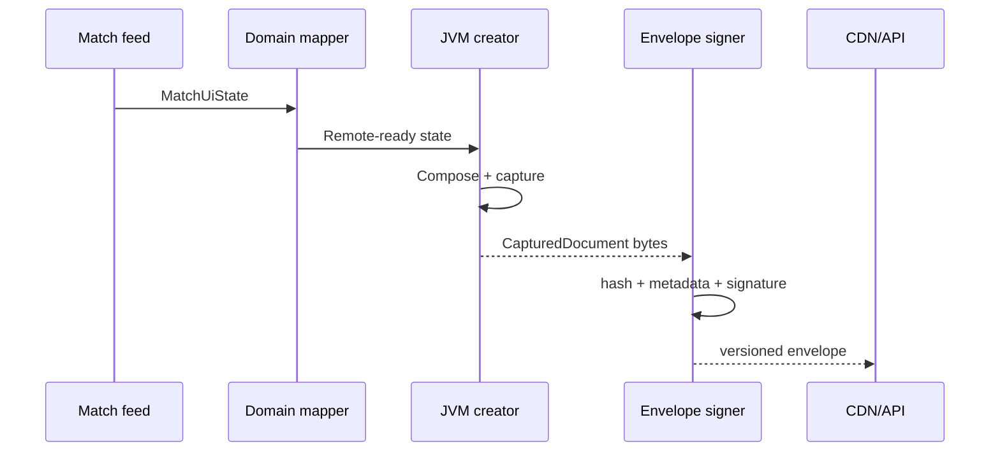
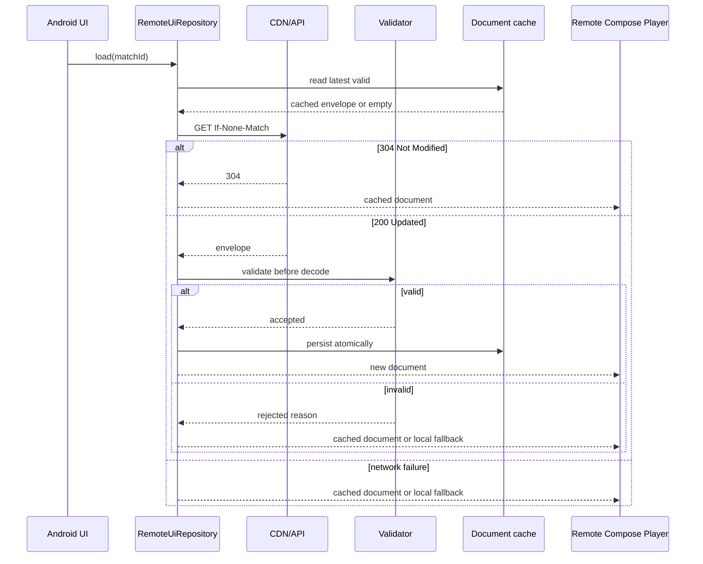

# Especificación técnica — Live Match Center con AndroidX Remote Compose

<aside>
🔄

**Documento vivo y regla de sincronización**

Esta especificación acompaña al artículo [Versión 2 — AndroidX Remote Compose: cuando la interfaz deja de viajar como componentes y empieza a viajar como instrucciones](https://app.notion.com/p/Versi-n-2-AndroidX-Remote-Compose-cuando-la-interfaz-deja-de-viajar-como-componentes-y-empieza-a--907497eb028c4275aa186a87208ed6bc?pvs=21).

Cada cambio del artículo que afecte el ejemplo —arquitectura, estados, APIs, seguridad, rendimiento, accesibilidad o alcance— debe actualizar esta especificación en la misma iteración. Si ambos documentos difieren, el artículo define la narrativa y esta página debe registrar el impacto técnico necesario para sostenerla con código ejecutable.

</aside>

| Campo | Valor |
| --- | --- |
| Estado | Borrador de especificación |
| Versión inicial | 0.1 |
| Baseline previsto | `androidx.compose.remote:remote-*:1.0.0-alpha18` |
| Artículo asociado | [Versión 2 — AndroidX Remote Compose: cuando la interfaz deja de viajar como componentes y empieza a viajar como instrucciones](https://app.notion.com/p/Versi-n-2-AndroidX-Remote-Compose-cuando-la-interfaz-deja-de-viajar-como-componentes-y-empieza-a--907497eb028c4275aa186a87208ed6bc?pvs=21) |
| Tipo de ejemplo | Backend Kotlin/JVM + host Android |
| Objetivo de entrega | Repositorio público reproducible |

# 1. Propósito

Construir un ejemplo ejecutable que demuestre por qué Remote Compose es relevante más allá de una tarjeta estática. El proyecto implementará un **Live Match Center** cuyo documento visual cambia según el estado de un partido, se genera fuera del host Android y se reproduce como un artefacto remoto validado.

El ejemplo debe sostener con evidencia las tesis centrales del artículo:

1. La estructura visual puede cambiar sin publicar una nueva versión de la app.
2. El dispositivo puede evaluar expresiones y animaciones locales sin recibir actualizaciones de red por frame.
3. El host conserva el control de las acciones y efectos secundarios.
4. El último documento válido puede reproducirse sin conexión.
5. Un payload inválido, vencido o incompatible produce un fallback seguro.
6. Los costes de distribución, validación y renderizado pueden medirse.

# 2. Fuera de alcance

La primera versión no intentará:

- construir una plataforma SDUI genérica;
- implementar un sistema completo de administración de eventos deportivos;
- enviar lógica de negocio descargable al dispositivo;
- sustituir la navegación, autenticación o dominio de la aplicación Android;
- demostrar superioridad de rendimiento sin benchmarks equivalentes;
- integrar apuestas, pagos, reproducción de video o datos personales;
- soportar iOS, web u otras plataformas no cubiertas por AndroidX Remote Compose.

# 3. Experiencia demostrada

El Live Match Center tendrá tres documentos o variantes reproducibles.



## 3.1 Scheduled

- Competición, equipos y horario de inicio.
- Acción `set_reminder`.
- Sin animación continua.
- Contenido apto para caché prolongada hasta acercarse al kickoff.

## 3.2 Live

- Marcador, período, reloj y último evento relevante.
- Indicador LIVE animado localmente.
- Acciones `open_match` y `open_highlight`.
- TTL breve y refresh condicional mediante ETag.
- El reloj visual no debe requerir una respuesta de red por segundo.

## 3.3 Finished

- Resultado final y estado de cierre.
- Acción `open_summary`.
- Documento estable y cacheable.

## 3.4 Estados de resiliencia

- **Suspended:** informa interrupción y conserva el último marcador válido.
- **Cancelled:** comunica cancelación sin mostrar acciones inválidas.
- **Invalid payload:** activa el fallback Compose local.
- **Offline:** reproduce el último documento válido e indica antigüedad si corresponde.

# 4. Arquitectura de referencia



# 5. Estructura propuesta del repositorio

```
remote-compose-live-match/
├── app-android/
│   ├── player/
│   ├── cache/
│   ├── security/
│   ├── actions/
│   └── fallback/
├── creator-jvm/
│   ├── composables/
│   ├── capture/
│   └── publisher/
├── contract/
│   ├── envelope/
│   ├── actions/
│   └── match/
├── benchmark/
│   ├── compose-local/
│   ├── sdui-json/
│   └── remote-compose/
├── fixtures/
│   ├── scheduled/
│   ├── live/
│   ├── finished/
│   └── invalid/
├── test-server/
└── docs/
    ├── screenshots/
    ├── benchmark-results/
    └── compatibility-matrix.md
```

## Responsabilidad por módulo

| Módulo | Responsabilidad |
| --- | --- |
| `contract` | Modelos de dominio compartidos, IDs de acción y envelope; sin Android UI |
| `creator-jvm` | Convierte estado de partido en documentos Remote Compose |
| `test-server` | Publica fixtures con ETag, expiración y respuestas de error controladas |
| `app-android` | Descarga, valida, cachea, reproduce y procesa acciones |
| `benchmark` | Compara implementaciones equivalentes |
| `fixtures` | Conserva documentos deterministas para pruebas y demos |

# 6. Contratos de datos

## 6.1 Estado de dominio

```kotlin
data class MatchUiState(
    val matchId: String,
    val competition: String,
    val home: TeamUi,
    val away: TeamUi,
    val homeScore: Int?,
    val awayScore: Int?,
    val phase: MatchPhase,
    val kickoffEpochSeconds: Long,
    val startedAtEpochSeconds: Long?,
    val period: String?,
    val latestEvent: MatchEventUi?,
    val revision: Long,
)
```

El modelo no debe contener tipos Android. El creador JVM debe poder ejecutarse sin Android SDK.

## 6.2 Envelope de distribución

```kotlin
data class RemoteUiEnvelope(
    val schemaVersion: Int,
    val documentId: String,
    val revision: Long,
    val matchId: String,
    val minHostVersion: Int,
    val createdAtEpochSeconds: Long,
    val expiresAtEpochSeconds: Long,
    val contentSha256: String,
    val signatureAlgorithm: String,
    val signature: String,
    val bytes: ByteArray,
)
```

La firma protege el envelope y los bytes como artefacto de distribución. No se asumirá que el formato interno `.rc` ofrece por sí mismo la política criptográfica necesaria.

## 6.3 Catálogo de acciones

| Action ID | Estado permitido | Comportamiento del host |
| --- | --- | --- |
| `set_reminder` | Scheduled | Solicita al host crear un recordatorio |
| `open_match` | Live | Abre el detalle nativo del partido |
| `open_highlight` | Live | Abre contenido permitido por el host |
| `open_summary` | Finished | Abre el resumen nativo |
| `refresh` | Suspended / error | Solicita una actualización controlada |

El documento emite intención; el host valida estado, sesión y permisos antes de actuar.

# 7. Flujo de creación



Requisitos:

- La captura debe ser determinista para el mismo fixture y configuración.
- El pipeline debe registrar versión de librería y configuración de display.
- Ningún secreto de firma debe formar parte del repositorio.
- Los fixtures publicados deben poder regenerarse mediante una tarea documentada.
- Una captura fallida no debe reemplazar el último documento válido.

# 8. Flujo del host Android



# 9. Validación y seguridad

El host debe validar antes de decodificar o reproducir:

1. tamaño máximo del envelope y de los bytes;
2. versión de schema conocida;
3. `minHostVersion` compatible;
4. timestamps coherentes y política de expiración;
5. SHA-256 del contenido;
6. firma del artefacto;
7. asociación entre `documentId`, `matchId` y revisión;
8. política de recursos externos;
9. IDs de acción contra una allowlist;
10. límites de frecuencia para refresh y reintentos.

## Matriz de fallos

| Fallo | Resultado esperado |
| --- | --- |
| Firma inválida | Rechazar, registrar y usar caché/fallback |
| Hash incorrecto | Rechazar antes del decode |
| Documento vencido con caché aceptable | Mostrar caché con indicador de antigüedad |
| Documento vencido sin caché | Fallback local |
| Host demasiado antiguo | Fallback local y métrica de incompatibilidad |
| Action ID desconocido | Ignorar, registrar y no ejecutar efectos |
| Imagen externa no permitida | Placeholder local |
| Decode o render error | Aislar error y sustituir por fallback |

# 10. Caché y actualización

- Clave primaria: `documentId + revision`.
- Escritura atómica: validar completamente antes de reemplazar la revisión activa.
- Conservar al menos la última revisión válida.
- Usar ETag para evitar descargar bytes sin cambios.
- Separar expiración de red de validez del fallback.
- Eliminar documentos obsoletos mediante una política de tamaño, no solo por edad.
- Nunca promover a “válido” un documento que no alcanzó el primer render correctamente.

# 11. Accesibilidad

La demo no se considerará completa hasta verificar:

- lectura del marcador como una frase coherente;
- descripciones de competición, fase y último evento;
- orden de foco estable;
- acciones con etiquetas comprensibles;
- tamaño táctil mínimo;
- contraste suficiente en todos los estados;
- comportamiento con font scale elevado;
- TalkBack en Scheduled, Live, Finished y fallback;
- reducción o eliminación del pulso LIVE cuando corresponda respetar movimiento reducido.

Los límites de semántica encontrados en la versión alpha deben documentarse como resultados, no ocultarse.

# 12. Observabilidad

Cada carga debe producir métricas sin datos sensibles:

- `document_id` y `revision`;
- origen: network, cache o fallback;
- resultado de validación;
- motivo de rechazo normalizado;
- bytes descargados;
- tiempo de validación y decode;
- tiempo hasta primer frame;
- action IDs aceptados o rechazados;
- errores de recursos externos;
- versión del host y versión de Remote Compose.

# 13. Estrategia de testing

## Unit tests

- mapping de `MatchUiState` a variantes;
- validación de envelope;
- allowlist de acciones;
- expiración y compatibilidad;
- selección de caché y fallback.

## Integration tests

- captura JVM de cada fixture;
- descarga, validación, persistencia y reproducción;
- 200, 304, timeout, payload truncado y firma inválida;
- actualización de Scheduled a Live sin reiniciar la app;
- restauración offline desde caché.

## Visual tests

- golden/screenshot por estado y tamaño de superficie;
- temas claro y oscuro si están soportados por el contrato;
- font scale representativo;
- diff visual entre revisiones.

## Accessibility tests

- árbol semántico esperado;
- labels y orden de navegación;
- pruebas manuales con TalkBack.

# 14. Plan de benchmark

Comparar la misma tarjeta y datos en:

1. Compose local;
2. renderer SDUI JSON mínimo;
3. Remote Compose.

| Métrica | Método |
| --- | --- |
| Tamaño del payload | Bytes comprimidos y sin comprimir |
| Validación + parse/decode | Benchmark aislado con fixtures equivalentes |
| Tiempo hasta primer frame | Macrobenchmark desde caché fría y caliente |
| Memoria incremental | Medición después de estabilizar cada implementación |
| CPU de animación | Ventana estable del indicador LIVE |
| Consumo de red | Secuencia Scheduled → Live → Finished |
| Recuperación offline | Tiempo hasta mostrar caché o fallback |

No se publicarán porcentajes comparativos hasta que el código, dispositivo, versión de Android y procedimiento sean reproducibles.

# 15. Criterios de aceptación

- [ ]  El creador se ejecuta en JVM sin Android SDK.
- [ ]  Los estados Scheduled, Live y Finished producen documentos distintos.
- [ ]  El host reproduce un fixture desde red y desde caché.
- [ ]  La transición de estado no requiere actualizar la APK.
- [ ]  El indicador LIVE se anima sin polling por frame.
- [ ]  Las acciones desconocidas nunca alcanzan la lógica de negocio.
- [ ]  Un documento corrupto activa caché o fallback sin cerrar la app.
- [ ]  El proyecto demuestra expiración, ETag y revisión.
- [ ]  Existen screenshots deterministas de cada estado.
- [ ]  TalkBack y font scale tienen resultados documentados.
- [ ]  Los benchmarks pueden repetirse con una tarea o script.
- [ ]  Todo snippet publicado en el artículo proviene de código compilable del repositorio.

# 16. Trazabilidad con el artículo

| Tesis o sección del artículo | Evidencia exigida en el ejemplo | Estado |
| --- | --- | --- |
| Bytes de entrada, acciones de salida | Envelope + dispatcher con allowlist | Parcial (WU10): allowlist de host implementada y testeada, y entrega end-to-end confirmada con taps reales en dispositivo para `set_reminder` (Scheduled, WU9), `open_match`/`open_highlight` (Live) y `open_summary` (Finished) (ver `docs/evidence/wu10-live-finished-actions.md`). Pendiente: envelope firmado, `refresh` (fase Suspended, aún no existe), y el efecto de dominio real detrás de cada acción |
| Creación JVM | Tarea que genera fixtures sin Android SDK | Hecho para Scheduled/Live/Finished (`generate*Fixture`/`check*Fixture`, WU2/WU4/WU5); Cancelled/Suspended pendientes |
| Expresiones locales | Reloj o pulso sin polling de red | Pendiente |
| Resiliencia | Caché y fallback ante payload inválido | Pendiente |
| Seguridad | Firma, hash, límites y acciones permitidas | Pendiente |
| Rendimiento | Benchmark reproducible | Pendiente |
| Accesibilidad | Resultados TalkBack y font scale | Pendiente |
| DX | Preview, fixtures, screenshots y tests | Pendiente |

# 17. Protocolo de actualización conjunta

Cuando se modifique el artículo principal:

1. identificar qué tesis, ejemplo o afirmación técnica cambió;
2. actualizar la fila correspondiente de trazabilidad;
3. ajustar requisitos, criterios de aceptación y preguntas abiertas;
4. incrementar la versión de esta especificación;
5. registrar el cambio en el historial inferior;
6. comprobar que los snippets del artículo siguen representando el repositorio;
7. evitar cerrar como hecho cualquier comportamiento todavía no verificado.

Cuando se modifique el código:

1. reflejar nombres y firmas reales en esta especificación;
2. actualizar el artículo solo si el cambio afecta la narrativa o las conclusiones;
3. reemplazar pseudocódigo por fragmentos compilables;
4. agregar evidencia visual o de benchmark cuando esté disponible.

# 18. Preguntas abiertas

- ¿Qué versión exacta de Remote Compose se fijará para el repositorio?
- ¿Cuál es la API pública soportada para obtener tiempo remoto y construir la animación LIVE?
- ¿Qué semántica expone el player Compose en la versión elegida?
- ¿Se puede ejecutar el creador completamente en JVM con todos los recursos requeridos?
- ¿Qué límites públicos existen para documento, imágenes y operaciones?
- ¿Qué adapter público existe entre documentos AndroidX y `RemoteViews.DrawInstructions`?
- ¿Qué dispositivo y versión de Android serán baseline del benchmark?
- ¿El test server será Ktor, fixtures estáticos o ambos?

# 19. Historial de cambios

| Versión | Fecha | Cambio | Impacto en el artículo |
| --- | --- | --- | --- |
| 0.1 | 2026-09-06 | Especificación inicial del Live Match Center | Formaliza el ejemplo propuesto en la versión 2 |
